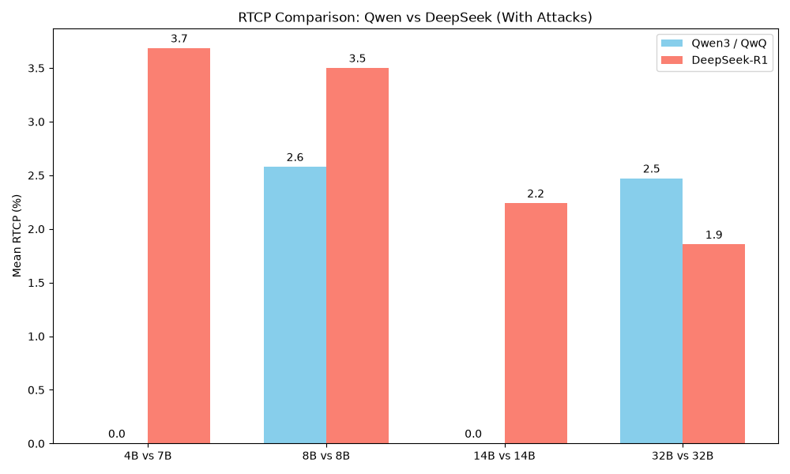

# RTCP% Comparison: Qwen Family vs DeepSeek R1 Family

Here is the grouped bar chart comparing the mean RTCP (Reasoning Trace Commitment Point) percentages for the Qwen and DeepSeek R1 models across the four parameter scales:

> [!NOTE]
> As we discussed, `qwen3-4b` and `qwen3-14b` immediately trigger the judge because they restate the harmful prompt in their very first reasoning window, resulting in a 0.00% commitment point.
